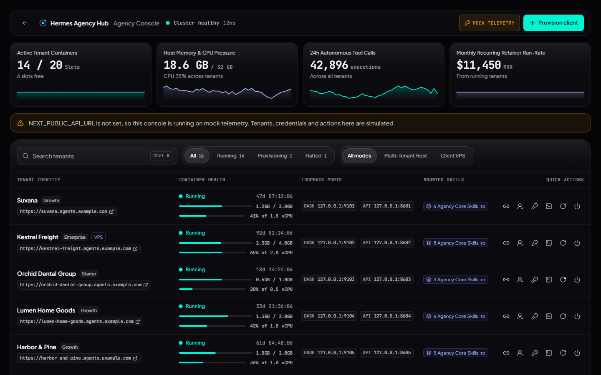
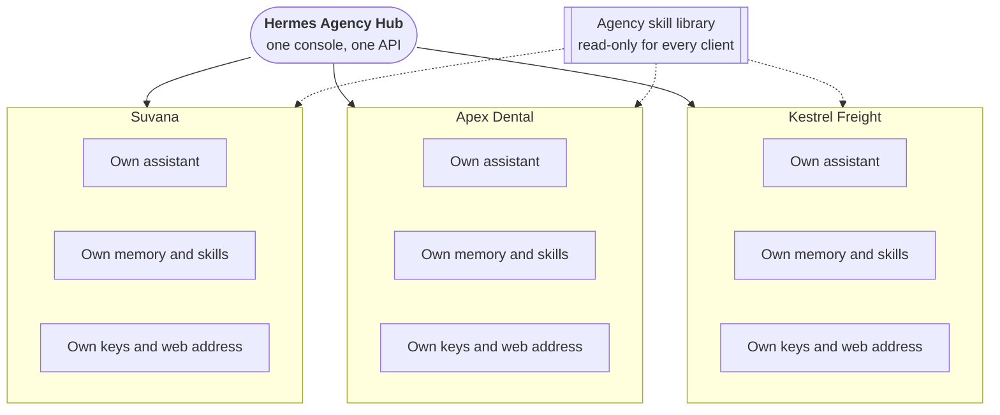
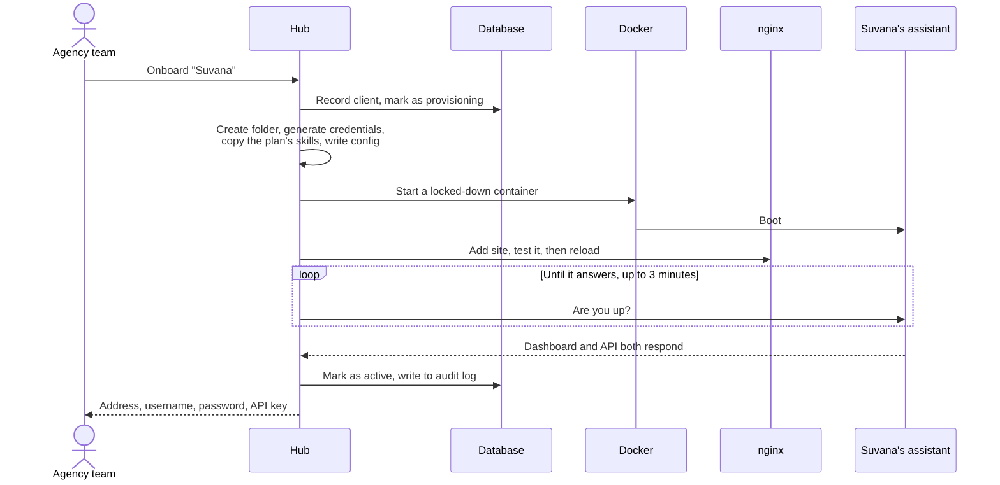
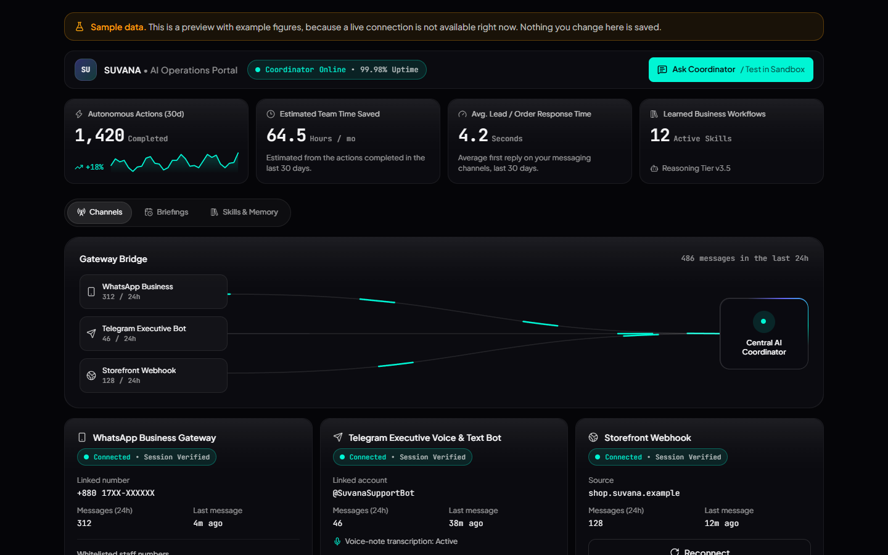
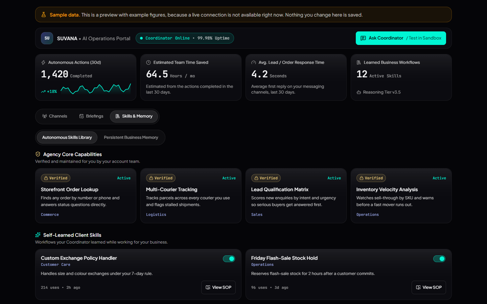
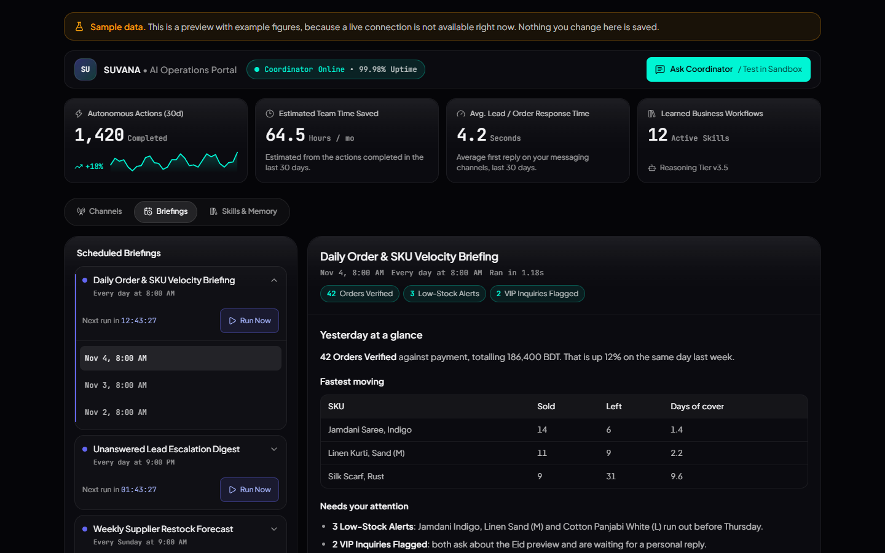
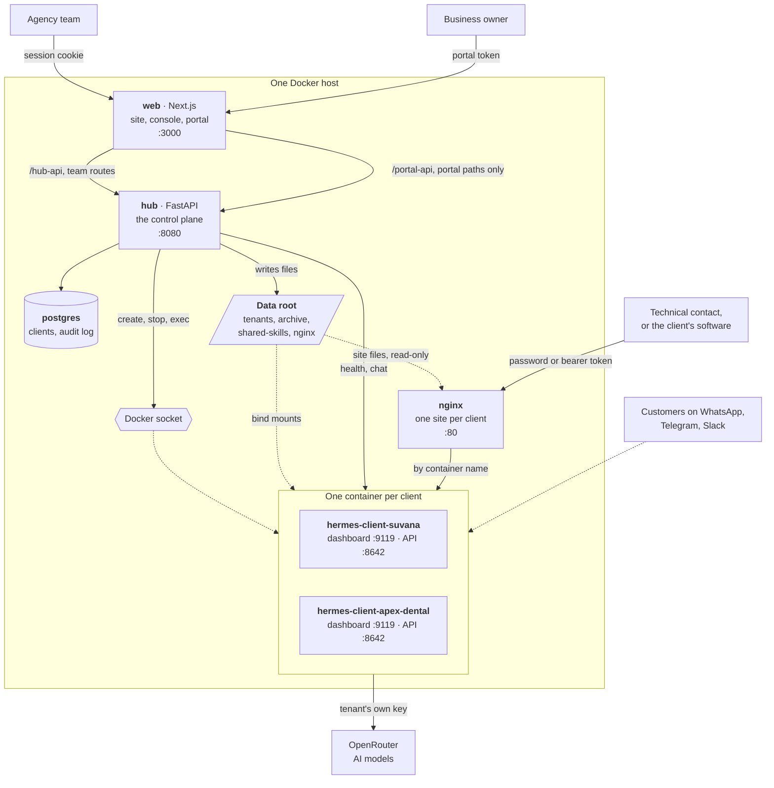
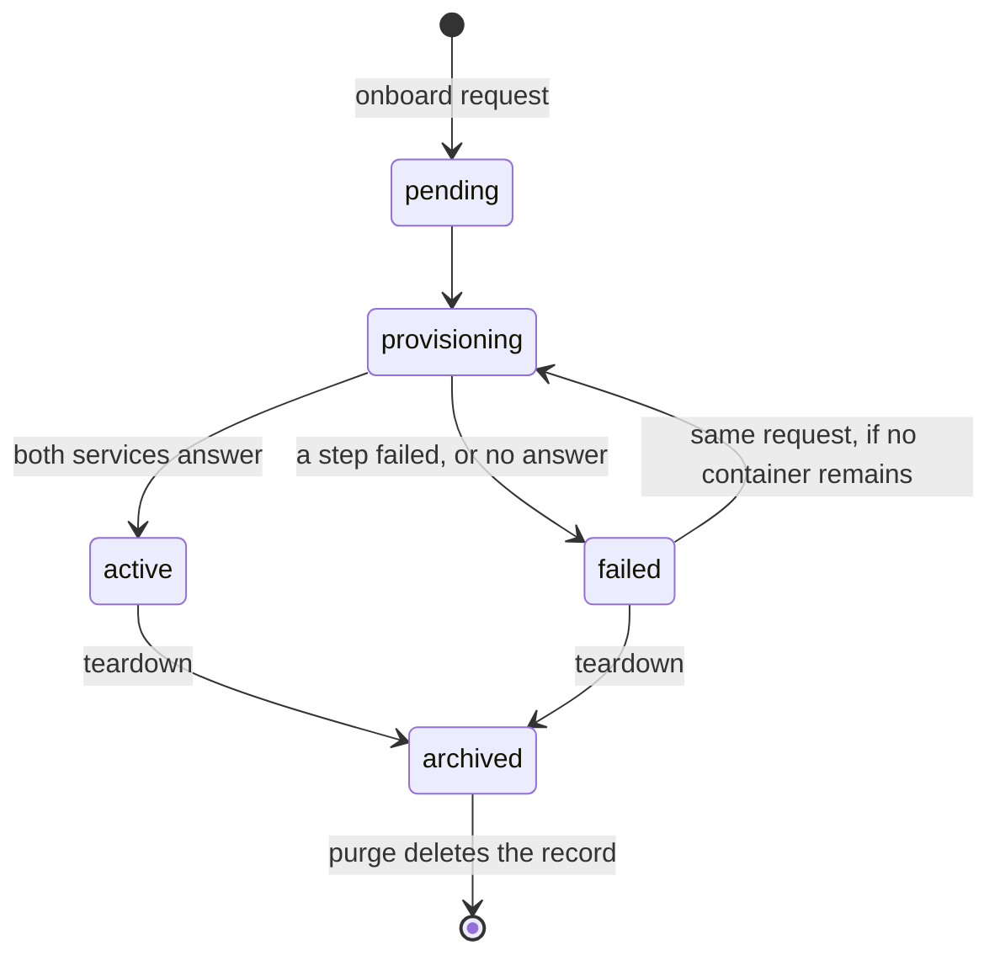

<div align="center">

# Hermes Agency Hub

### One console. One private AI assistant per client.

An agency uses this product to give each of its clients an AI assistant that answers<br/>
their messages, learns their business and reports back, with each one in its own locked-down container.

[The story](#act-i-why-this-exists) · [Architecture](#act-iii-how-it-is-built) · [All features](#act-iv-everything-it-does) · [What isn't finished](#slide-17-what-isnt-finished) · [Try it](#act-v-try-it)

</div>



<div align="center"><sub>The agency console, running on its built-in sample data.</sub></div>

---

## The 30-second version

| | |
|---|---|
| **Who it's for** | Agencies that sell AI operations to small businesses |
| **What a client gets** | An assistant called the "AI Operations Coordinator", running on their channels, with its own memory, skills and schedule |
| **What the agency gets** | One console and one API to create, watch and remove every client's assistant |
| **The key idea** | A separate container for every client, so one client's data, keys and memory never sit in another client's assistant |
| **Built on** | [Hermes Agent](https://github.com/NousResearch/hermes-agent) by Nous Research, the AI agent that runs inside each container |
| **Where it stands** | The control plane and client portal work and are tested. Some things the website shows are not built yet. [Slide 17](#slide-17-what-isnt-finished) lists them |

### Local demo sign-ins

On a local install (`ENVIRONMENT=local`) with no `AUTH_SEED_PASSWORD`, an empty database is seeded with these accounts. They are written in the source, so they are **never** created anywhere else: staging and production need `AUTH_SEED_PASSWORD` or no accounts are made.

| Where | Email | Password | Role |
|---|---|---|---|
| `/login`, Agency Console | `ishtiaq@weblaud.com` | `WeblaudAdmin!2026` | Super Admin |
| | `sakib@weblaud.com` | `WeblaudAdmin!2026` | Super Admin |
| | `jubayed@weblaud.com` | `WeblaudSales!2026` | Sales Ops |
| `/login`, SMB Client Portal | `owner@suvana.com` (subdomain `suvana`) | `ClientPortal!2026` | Owner, online store |
| | `owner@apex-dental.com` (subdomain `apex-dental`) | `ClientPortal!2026` | Owner, dental clinic |

A client owner can also use the 6-digit magic code, which is `246810` while delivery is simulated. If the database already has users, nothing is re-seeded and their old passwords stay.

The role pills on the console login only fill in passwords when the website is built with `NEXT_PUBLIC_DEMO_LOGINS=true` (the start script sets it). Without it they pick the account and you type the password.

### How this deck is organised

| Act | Question it answers | Slides |
|---|---|---|
| [**I. Why this exists**](#act-i-why-this-exists) | What problem does it solve? | 1–2 |
| [**II. A client's first week**](#act-ii-a-clients-first-week) | What does using it feel like? | 3–8 |
| [**III. How it is built**](#act-iii-how-it-is-built) | How does it actually work? | 9–14 |
| [**IV. Everything it does**](#act-iv-everything-it-does) | What's included, and what isn't? | 15–17 |
| [**V. Try it**](#act-v-try-it) | How do I run it myself? | 18–19 |
| [**Appendix**](#appendix-reference) | API, tests and operations reference | |

**Three words used throughout:** a **client** is a business the agency serves. A **tenant** is that client's running assistant and its files. A **container** is an isolated box on the server, with its own files and limits, that a program runs inside.

---

## Act I: Why this exists

### Slide 1: The problem

An agency has ten small-business clients. Each one wants the same thing: an assistant that answers customers on WhatsApp, qualifies new leads and sends a summary every morning.

An AI agent can do this work. Running one for *ten different businesses* is the hard part, and the two obvious approaches both fail:

| The obvious approach | Why it breaks |
|---|---|
| **One shared agent for everyone** | One client's customers, prices and passwords sit next to another's. The agent can run shell commands, so a single mistake or a clever message could expose all of them. |
| **Set one up by hand for each client** | Safe, but slow. Every client means hours of server work, and ten hand-built setups soon become ten slightly different ones that nobody can maintain. |

There's a third problem too. The client's owner wants to see what the assistant is doing, but shouldn't be shown server logs or the names of the agency's suppliers.

> **In short:** the agency needs the safety of separate setups with the effort of a shared one, plus a view fit for a business owner.

### Slide 2: The idea

**Make creating a client's assistant a single API call, and give each one its own locked-down container.**



<sub>Suvana, Apex Dental and Kestrel Freight are fictional companies from the product's sample data.</sub>

One request does all of this:

1. Generates the client's passwords and keys
2. Writes the assistant's configuration
3. Starts a locked-down container
4. Publishes a web address at `<client>.<your-domain>`
5. Checks that the assistant actually answers

If any step fails, the steps before it are undone. Nothing half-built is left pretending to work.

> **In short:** a new client takes one request and about 20 seconds, once the agent image is downloaded.

---

## Act II: A client's first week

*Follow one client from signing up to leaving. Suvana is a fictional online shop, used here because it's the example in the product's sample data.*

There are four people in this story:

| Who | What they want | Where they go | How they get in |
|---|---|---|---|
| **The agency team** | Run every client from one place | Console at `/admin` | Email and password, with a role |
| **The business owner** | See results, approve work, and correct the assistant | Portal at `/portal/<client>` | Password, one-time code, or private link from the agency |
| **The technical contact** | Full control of this one assistant | Dashboard at `<client>.<domain>` | Username and password |
| **The customer** | An answer | WhatsApp, Telegram or Slack | Just sends a message, and never sees any of this |

### Slide 3: Monday morning, the agency signs Suvana

Someone on the agency team clicks **Provision client** and fills in a short form. Behind that form:



The team gets back everything needed to hand over. **The dashboard password appears only this once.** The hub keeps a scrambled hash of it and can't recover the original.

> **In short:** nobody touched a server, and the database has a record of each step.

### Slide 4: Monday afternoon, the owner opens the portal

The agency sends the owner a private link. The portal shows how the business is doing, in business language:



<div align="center"><sub>The client portal, showing its clearly labelled sample data.</sub></div>

The owner sees a "Coordinator", actions completed and time saved. **The portal is built never to name Hermes, Docker, OpenRouter or any other supplier**, so the agency can present it under its own name. [Slide 12](#slide-12-where-the-secrets-live) covers the limits of that.

Two details protect the owner and the agency:

- The access token sits in the part of the link that browsers don't send to servers, so it stays out of server logs.
- The owner's browser only ever talks to the website, never to the hub. The hub, which can create and delete containers, stays off the public internet.

> **In short:** the owner gets a real view of the work, with none of the machinery showing.

### Slide 5: Tuesday, the customers arrive

The agency's skill library gives every assistant a head start. A skill is a written playbook that the assistant follows, and two ship today:

| Skill | The situation | What the assistant does |
|---|---|---|
| **Lead qualification** | A stranger sends a first message | Works out need, authority, budget and timeline, asking at most two questions per reply. Then records a recommendation: pursue now, nurture or decline. |
| **E-commerce lookup** | "Where is my order?" | Looks the order up rather than guessing, and only discusses it with the address that placed it. Anything that moves money, such as a refund or cancellation, goes to a person. |

The assistants can read the shared library but not change it, so every client gets the same version.

> **In short:** each assistant starts with the agency's best practice, written down once and shared by all.

### Slide 6: Wednesday, the assistant learns the business

The owner notices that the assistant doesn't know the delivery times, so they type a rule into the portal: *"Delivery inside the city takes 2 days."*



<div align="center"><sub>Skills &amp; Memory, showing sample data. The sample skills are illustrations, and only the two on the previous slide ship today.</sub></div>

The assistant improves in two ways:

- **The owner teaches it.** Rules go straight into its memory. Text that reads like an attack, such as "ignore all previous instructions", is refused.
- **It teaches itself.** Hermes Agent can write new skills as it works. The portal shows these separately, and the owner can switch any of them off.

> **In short:** the assistant gets better at this one business, and the owner stays in charge of what it has learned.

### Slide 7: Thursday, the first morning briefing

Scheduled jobs run inside the assistant. Each report appears in the portal, ready to read, and the owner can press **Run Now** for a fresh one.



<div align="center"><sub>Briefings, showing sample data.</sub></div>

> **In short:** the assistant reports in on its own schedule, without anyone asking.

### Slide 8: Friday, a bad day, and then goodbye

Things go wrong, and the product is built around two rules: **never leave a half-built client behind, and never report success that isn't true.**

| What goes wrong | What happens |
|---|---|
| A step fails during setup | The route and container are removed in reverse order, the failure is recorded, and the ports are released. The client's files are kept. Sending the same request again retries it. |
| The assistant starts but doesn't answer | It's marked **failed**, not active. The container stays so someone can read its logs, and the credentials are still returned, with a warning. |
| Two clients are given the same port | The hub tries a new pair of ports, up to 4 times. |
| A new web configuration is invalid | nginx tests it first. If it's rejected, the change is rolled back, so one bad client can't take the others offline. |
| One client's assistant stops | That client's visitors get an error. Everyone else carries on, and nginx can still reload and restart. |
| The hub crashes partway through | A lone `started` row stays in the audit log as evidence, for a person to find and follow up. |
| The portal can't reach its backend | The page shows sample data under a clear banner. If the backend answers at all, even to refuse a token, sample data is never shown, because fake figures could be read as real. |

And when a client leaves, the agency clicks **Terminate instance** and types the client's subdomain to confirm. The container stops, the route goes, and the client's data moves to an archive. The agency can permanently delete it instead if it prefers.

> **In short:** one client's failure stays that client's problem, and the record always shows what really happened.

---

## Act III: How it is built

*From here on, the deck is written for engineers.*

### Slide 9: The whole system

Everything runs from a single `docker-compose.yml`, the same file on a laptop and on a VPS.



**The six compose services**

| Service | Job | Reachable at |
|---|---|---|
| `hub` | The control plane: API, provisioning, portal backend | `127.0.0.1:8080` |
| `web` | Marketing site, agency console, client portal | `127.0.0.1:3000` |
| `nginx` | Routes `<client>.<domain>` to the right tenant | Port `80` |
| `postgres` | Client records and the audit log | Not published |
| `hub-init` | Prepares the data root once per `up`, then exits | |
| `agent-image` | Pulls the agent image during `up`, then exits | |

**Two Docker networks:** `hermes-internal` carries the hub, website and database. `hermes-clients` carries the hub, nginx and all tenants. The website isn't on the tenant network at all, and tenants can't reach the database.

### Slide 10: Five ways in

Every route into the system has its own credentials and its own limits.

| Door | Who uses it | Path | Credential | Can reach |
|---|---|---|---|---|
| **Agency console** | Agency | Browser → `web:3000/hub-api` → hub | Session cookie | What the person's role allows |
| **Admin API** | Scripts | Program → `hub:8080/api/v1` | `X-API-Key` | Everything, as Super Admin |
| **Client portal** | Business owner | Browser → `web:3000/portal-api` → hub | Session cookie, or a signed token for one client | That client's portal routes only |
| **Tenant dashboard** | Technical contact | Browser → nginx → tenant `:9119` | Username and password | That tenant |
| **Tenant API** | Client's software | Program → nginx `/v1/` → tenant `:8642` | Bearer token | That tenant. OpenAI-compatible, and not white-labelled |

Session cookies are HttpOnly and SameSite=Lax, and are checked against the user's row on every request, so signing out or changing a role takes effect at once. The route guard in `frontend/src/proxy.ts` only chooses where to send people. The hub makes every access decision, using the matrix in `backend/src/auth/permissions.py`:

| Role | Can reach | Cannot |
|---|---|---|
| `SUPER_ADMIN` | Everything | |
| `GROWTH_OPS` | Clients, Shadow-Week QA, skills, ROI, and looking at any client's portal | Provision or terminate containers, change server or billing fields, decide for an owner |
| `SALES_OPS` | Prospect CRM, audit tracker, stand-up, onboarding drafts | Read the fleet, logs, secrets or any client's portal |
| `CLIENT_OWNER` | Their own portal | Anything else. Another client's portal answers `403` |

Portal tokens are HS256 JWTs signed with a key derived from that client's own secret. A token for one client can't verify against another, even with a forged subject, and rotating the secret revokes all of that client's links at once.

The console's browser calls the hub directly, and the hub binds to loopback by default. On a server, the agency therefore needs its own private route to the hub.

### Slide 11: Inside a tenant

Each client runs inside the same hardened envelope:

```
command         sleep infinity
memory          2g
cpus            1.0
pids_limit      200
cap_drop        ALL
cap_add         CHOWN SETUID SETGID FOWNER DAC_OVERRIDE
security_opt    no-new-privileges:true
restart         unless-stopped
ports           127.0.0.1:<19000-19499>:9119   (web dashboard)
                127.0.0.1:<19500-19999>:8642   (OpenAI-compatible API)
volumes         <data_root>/tenants/<subdomain> -> /opt/data              rw
                <data_root>/shared-skills       -> /opt/data/skills/agency_core  ro
```

And the files on the host, using `acme.localhost` as the example subdomain:

```
/srv/hermes-multi/
├── tenants/
│   └── acme.localhost/      this client's whole world, mounted at /opt/data
│       ├── .env             secrets, mode 0600
│       ├── config.yaml      agent settings
│       ├── memories/        MEMORY.md, the business rules
│       └── skills/          plan skills, plus skills the agent wrote itself
├── shared-skills/           the agency library, mounted read-only into every tenant
├── archive/                 data of departed clients, moved here on teardown
└── nginx/conf.d/            one generated site per client
```

**Why those capabilities?** They are the minimum the image's s6-overlay init needs to chown the data volume and drop each service to an unprivileged user. A bare `cap_drop: ALL` leaves the supervision tree unable to start anything. `NET_RAW`, `NET_ADMIN`, `SYS_ADMIN`, `SYS_PTRACE` and about 35 others stay dropped.

**Why `sleep infinity`?** It's the container's main program, and the entrypoint stays the image's own. When the main program exits, s6 shuts every service down. With no command it would be the interactive CLI, which exits at once without a terminal. The gateway and dashboard run as supervised services alongside it.

### Slide 12: Where the secrets live

| Secret | Stored in | Notes |
|---|---|---|
| Client's OpenRouter key | The tenant's `.env` (mode 0600) only | The hub's database keeps just the last 4 characters, for support |
| Dashboard password | Nowhere in plain text | Returned once at onboarding. The database holds an scrypt hash |
| Dashboard session secret | Hub database and the tenant's `.env` | Keeps logins valid across restarts |
| Tenant API key, `sk-acme.localhost-…` | Hub database and the tenant's `.env` | Returned at onboarding. The hub's API doesn't return it again, but it can be read from the tenant's `.env` |
| Per-client `internal_token` | Hub database only | Never written into tenant files. Portal tokens are signed with a key derived from it |
| Portal token | Not stored | Signed, carried in the link's fragment, expires after 90 days by default |
| Admin API key | The hub's own `.env` | Opens every client, so keep it out of browsers you don't control |

The agent loads `/opt/data/.env` with `override=True`, so that file beats anything passed as a container environment variable. Secrets therefore go only in that file, which also keeps them out of `docker inspect`. A few non-secret settings go in both places (`DOCKER_ENV_KEYS`), because the image's s6 scripts read the process environment and never see the file.

**The white-label boundary is treated as hostile territory.** The agent has a shell, so anything in its folder could be a trap:

- **A symlink could point at another client's `.env`.** Anything that doesn't resolve to exactly itself is refused, for reads and writes alike.
- **Scheduled job documents contain the job's private prompt.** Only the framed response is returned, and a document that can't be framed returns nothing.
- **The agent copies its bundled skills into `skills/`.** `.bundled_manifest` and `.hub/lock.json` identify them, so vendor skills are never presented as "learned".
- **Portal actions cost money or restart services.** Per client: chat 20/minute, run-now 5/minute, channel test 6/minute, channel refresh once per 2 minutes.

**What this boundary doesn't guarantee:**

- **Business rules are screened, not proven safe.** A pattern list raises the bar against prompt injection but can't recognise every paraphrase.
- **Chat is as capable as the agent.** Replies are scrubbed of platform vocabulary and the client's exact secrets, and the agent is told not to reveal its internals, but an instruction can be argued with. An owner who persuades it to quote `SOUL.md` will see text no pattern can recognise. Closing that needs a restricted toolset on the agent's side.
- **Uptime is an upper bound.** Docker records only the most recent stop, so earlier outages in the window aren't counted.

### Slide 13: A client's life, and the code behind it



Every step writes to an append-only audit log, normally as a `started` row followed by `succeeded` or `failed`. A `suspended` state also exists for lapsed billing, but nothing sets it yet.

**Backend** (`backend/src/`)

```
main.py                    FastAPI app, lifespan, exception -> status mapping
api/clients.py             the admin HTTP surface
clients/
  models.py                Client + AuditLog
  schemas.py               request/response shapes
  service.py               persistence only: no Docker, no HTTP
  skills.py                per-plan skill sync
orchestrator/
  provisioner.py           THE COORDINATOR: the only module holding database,
                           Docker, filesystem and nginx at once, and so the
                           only one that can roll back
  docker_service.py        container lifecycle, security envelope, probes
  credentials.py           scrypt hashing + per-tenant secret generation
  templates.py             renders .env, config.yaml and the nginx site
portal/                    the client portal, and its own trust boundary
  portal_router.py         routes and per-tenant authentication
  readers.py               the agent's on-disk layout -> what an owner sees
  tenant_files.py          file access locked to one tenant's directory
  sanitize.py              white-label scrub; business rule screening
  tokens.py                per-tenant signed access tokens
  pairing.py               WhatsApp re-linking through the agent's own bridge
  tenant_api.py            calls to a tenant's API
proxy/
  nginx.py                 site files, validate-before-reload
  service.py               routing facade + port allocation
  traefik.py               label-based alternative (off, and not in compose)
```

**Frontend** (`frontend/src/`)

```
app/page.tsx               marketing site
app/admin/                 agency console
app/portal/[subdomain]/    client portal
app/portal-api/[...path]/  the only door from the portal to the hub
components/                landing, admin, portal and shared ui
lib/mock-hub.ts            sample data for the console
lib/portal-mock.ts         sample data for the portal
```

**Elsewhere:** `backend/templates/` holds the four Jinja templates, `backend/migrations/` the Alembic schema, `shared-skills/` the skill library, and `scripts/` the code behind `start.bat` and `stop.bat`.

### Slide 14: Three things that are easy to get wrong

These decisions look odd until you know why they exist. Read this slide before changing the Docker or nginx setup.

**1. The Docker daemon resolves bind-mount paths, not the hub.** The hub creates *sibling* containers through the mounted socket. If it wrote tenant files to a path only it could see and passed that string as a bind source, the daemon would resolve it against the host, find nothing, and hand the tenant an empty directory. So `/srv/hermes-multi` is mounted into the hub at the same absolute path. `Settings.to_host()` handles the case where that's impossible (`DATA_ROOT_HOST`).

**2. Published ports live on the host's loopback, not the hub's.** A containerized hub probing `127.0.0.1:19000` hits its own loopback, and a containerized nginx hits nginx's. So both reach tenants over the `hermes-clients` network by container name (`probe_mode` and `nginx_upstream_mode` set to `network`). The loopback ports stay published for host-side debugging and for the host-nginx deployment.

**3. nginx looks up each tenant per request, not at startup.** nginx refuses its whole config if a name in an `upstream` block doesn't resolve when it loads, so one stopped tenant would block every later reload. Under `network` mode, tenant sites use Docker's DNS (`127.0.0.11`) and `proxy_pass` through a variable. A stopped tenant's visitors get a 502 and everyone else is unaffected. The trade-off is no upstream keepalive.

---

## Act IV: Everything it does

### Slide 15: The feature list

✅ Working and covered by tests  ·  🟡 Works with a limit you should know about  ·  ⛔ Shown on the website or in the console, but not built

#### Client lifecycle

| | Feature | Notes |
|---|---|---|
| ✅ | One-call onboarding | Credentials, config, container, route and health check |
| ✅ | Automatic rollback | Undoes the steps already done if one fails, and keeps the client's data |
| ✅ | Retry after failure | The same request, with the same contact email, reuses the failed client's record if no container remains |
| ✅ | Port allocation | Dashboard 19000–19499, API 19500–19999, retried on a clash |
| ✅ | Teardown | Archive the data, or delete it and the record too |
| ✅ | Audit trail | Lifecycle and portal actions, per client |
| ✅ | Health report | Container state plus a live probe of both services |
| ✅ | List, search, filter, stats, update, logs | Through the API |
| 🟡 | Packages (Presence, Growth, Scale) | Each package sets a plan and a list of skills, and e-commerce skills are disabled for general businesses. Every tenant still mounts the whole library read-only, so a Presence assistant can still find the higher-tier skills |
| 🟡 | Changing a client's plan | Updates the record, but doesn't resize a running container. Docker can't do that in place |

#### Agency console

| | Feature | Notes |
|---|---|---|
| ✅ | Provisioning form | With a results screen showing the one-time password |
| ✅ | Fleet table | Search (`Ctrl+K`), status filter, health and ports for each client |
| ✅ | Log viewer | A drawer that follows a client's container logs |
| ✅ | Copy portal link | Issues a fresh link for the client in one click |
| ✅ | Terminate with confirmation | You type the client's subdomain to confirm |
| ✅ | Sample-data mode | Runs with no hub connected, under a clear notice |
| 🟡 | Fleet figures | On a live hub, per-client memory and CPU use aren't available and the tool-call count is empty. Monthly revenue is an estimate from list prices |
| 🟡 | Copy API key | Only available from the onboarding response on a live hub. The password is also shown only then |
| ⛔ | Restart button | Works on sample data only, because the hub has no restart route yet |

#### Client portal

| | Feature | Notes |
|---|---|---|
| ✅ | Five tabs | Overview, Social Autopilot, ROI & Growth, Guardrails & Approvals, Channels & Memory |
| ✅ | Social autopilot | Draws a branded 1080 px post with `generate_social_visual.py`, publishes with `meta_publisher.py`, and answers comments with a public reply plus a DM handoff. Zero-touch or one-tap approval, and Shadow Week still sends posts through Weblaud QA first |
| 🟡 | Social publishing to Meta | With no Meta credentials it runs in a labelled **sandbox**: nothing is posted. Live publishing is wired for one tenant (`META_LIVE_TENANT`) and has not been run against a real page. Reach is shown as unknown, and incoming live comments are not received yet |
| ✅ | White-label overview | Status, 30-day activity, estimated time saved |
| ✅ | Channel status | WhatsApp, Telegram, Slack and web widget, with masked handles and 24-hour volume |
| ✅ | Approved senders | Change who may message the assistant, per channel |
| ✅ | Scheduled briefings | Read reports and run a job now. Creating a schedule happens inside the agent |
| ✅ | Skills | Agency skills and learned skills, with an on/off switch for learned ones |
| ✅ | Business memory | Add, replace or remove rules, with injection screening |
| ✅ | Chat with the Coordinator | Replies scrubbed of platform names and the client's secrets |
| ✅ | Access links | Set an expiry, or revoke all earlier links for a client |
| 🟡 | Channel connection, test and re-link | Includes a Telegram test message and WhatsApp QR re-linking. Built and tested against fakes, but [not yet run with real accounts](#slide-17-what-isnt-finished) |

#### What each assistant can do (from Hermes Agent)

| | Feature | Notes |
|---|---|---|
| ✅ | Web dashboard | One per client, behind a generated login |
| ✅ | OpenAI-compatible API | At `<client>.<domain>/v1`, with streaming passed through by nginx |
| ✅ | Persistent memory | In `memories/MEMORY.md` |
| ✅ | Self-written skills | Hermes Agent's own ability, kept per client |
| ✅ | Scheduled jobs | `hermes cron`, per client |
| 🟡 | Lead qualification skill | The playbook ships. It works on whichever channel is connected |
| 🟡 | E-commerce lookup skill | The playbook ships, but the hub has no store integration, so the assistant needs access to the store's data arranged per client |

#### Security

| | Feature | Notes |
|---|---|---|
| ✅ | Hardened container | No extra capabilities, no privilege escalation, memory, CPU and process limits |
| ✅ | Loopback-only ports | Public traffic has to pass through nginx |
| ✅ | Secret separation | See [slide 12](#slide-12-where-the-secrets-live) |
| ✅ | Hostile-file handling | Symlinks refused, reads and writes locked to the client's folder |
| ✅ | Non-root hub, database not published | The hub runs as uid 10001 |
| 🟡 | Isolation between clients | Files, keys and limits are separate, but [the network is shared](#slide-17-what-isnt-finished) |

#### Deployment and website

| | Feature | Notes |
|---|---|---|
| ✅ | One-command startup | `docker compose up -d --build`, with migrations on start |
| ✅ | Double-click startup on Windows | `start.bat` and `stop.bat`, with a demo client |
| ✅ | nginx modes | `docker` (default), `systemctl` for a host nginx, `none` for tests |
| ✅ | Marketing site | Features, skills, pricing and a return-on-investment estimator |
| 🟡 | Traefik mode | Code exists, off by default, and compose doesn't include a Traefik service |
| ⛔ | The rest of [slide 17's list](#slide-17-what-isnt-finished) | HTTPS, billing, installer and more |

### Slide 16: The business model

The website offers an agency's clients two ways to buy:

| | Starter | Growth | Dedicated Enterprise |
|---|---|---|---|
| **Managed monthly retainer** | $299 | $699 | $1,500 |
| **On-premise license** | Custom quote | Custom quote | Custom quote |
| **Conversations listed** | 1,000 | 10,000 | 100,000 |
| **Hub plan name** | `starter` | `growth` | `scale` |

The site also has a calculator where a visitor enters hours saved and hourly cost to estimate their return. These prices are list prices on the website. Nothing charges them yet, and the on-premise option depends on an installer that [doesn't exist yet](#slide-17-what-isnt-finished).

The running costs per client are the server capacity for one container (up to 2 GB of memory and 1 vCPU) and the AI usage, which is billed to the OpenRouter key supplied for that client.

### Slide 17: What isn't finished

The marketing site and console describe where the product is heading, and in places that's ahead of the code. **Read this before promising anything to a client.**

**Shown, but not built**

| What's shown | What's actually there |
|---|---|
| "Issuing Let's Encrypt SSL certificate" during provisioning; "Automated SSL" on pricing | nginx listens on port 80 only, and the provisioning stages shown in the console are display text. **A real deployment needs HTTPS added in front.** |
| "One-Click On-Premise License" and the generated installer command | `install-client-hermes.sh` isn't in this repository, so the command fails |
| "Dedicated Client VPS" | Sample data only. The hub runs every tenant on its own host |
| Different resources per tier (1 GB to 4 GB) | Every plan gets 2 GB and 1 vCPU |
| Choosing an AI model when provisioning | No file the tenant reads contains the choice, so it runs the image's default model |
| Approving an item in the portal | Records the decision and audits it. **It doesn't yet tell the agent to act**, because the agent has no route for receiving that instruction, and agents can't yet add drafts to the queue either |
| Monthly ROI figures and workspace rows | Entered by the team or through the API. Nothing feeds them automatically from the agent yet |
| WhatsApp and email one-time codes | Simulated on a local install. Elsewhere the route answers `503` |
| Billing | Stripe fields and settings exist, but no route uses them |
| Inbound webhooks: Shopify, CRM, MCP Inspector | The animated homepage graph is labelled as simulated, and `webhooks/` is empty |

**Open risks**

| Risk | Detail |
|---|---|
| **Tenants share a network** | They can reach each other and the hub directly. Each service still requires credentials, but the agent has a shell, so this weakens isolation. A network per tenant would fix it. |
| **The hub holds the Docker socket** | That's root-equivalent on the host. It's why the hub binds to loopback by default. Don't expose it without care. |
| **Re-provisioning destroys data** | It deletes learned skills and rewrites `.env`, which loses messaging tokens. Don't re-provision a client whose data matters. |
| **A rejected AI key confuses the owner** | The name filter rewrites the agent's error, so the portal tells the owner to run `Coordinator setup` in a terminal, which they can't do. |
| **`latest` can change under you** | It moved from agent 0.22.5 to 0.22.6 during testing, and the default model changed with it. Pin a version in production. |
| **Docker Desktop storage** | Tenant files appear to be on temporary storage, so restarting Docker Desktop may lose them. Check this before relying on it. A Linux host shouldn't be affected. |

**Not yet confirmed end to end** ([full record](LOCAL_TESTING.md#how-this-guide-was-verified))

- A successful AI reply using a real OpenRouter key. Everything up to the provider is confirmed: the placeholder key reaches OpenRouter and gets rejected.
- Telegram and WhatsApp with real accounts.
- A full click-through of the console and portal against a live hub.

---

## Act V: Try it

### Slide 18: Run it in 15 minutes

**You need:** Docker Desktop with about 8 GB of memory and 6 GB of free disk, and ports 80, 8080 and 3000 free.

**On Windows, double-click `start.bat`.** It writes local test settings, starts everything, creates a demo client and prints the logins. The first run downloads about 4.3 GB. `stop.bat` stops everything and keeps your data.

| Open | To see | Log in with |
|---|---|---|
| http://localhost:3000 | The marketing site | Nothing |
| http://localhost:3000/login | The agency console | `sakib@weblaud.com` and the printed password |
| http://localhost:3000/login?tab=client | The demo owner's portal, with sample figures | `owner@suvana.com` and the printed password, or a one-time code |
| http://demo.localhost | The demo client's dashboard | `admin` and the printed password |
| The printed portal link | The demo client's portal | The link is the login |
| http://localhost:8080/docs | The hub's interactive API docs | `X-API-Key` |

**First sign-in.** When the users table is empty, the hub creates the agency team and, on a local install, the demo owner. `AUTH_SEED_PASSWORD` sets their password. Left blank on a local install, a password per account is generated and logged once: `docker compose logs hub | findstr Seeded`. Outside a local install it is required, and no accounts are created without it. Change it after signing in, from the profile menu. If a generated password is lost, reset it with the admin key: `PATCH /api/v1/auth/users/{id}`.

**One-time codes are simulated.** No WhatsApp or email provider is connected, so a local install shows the code on screen, and any other environment answers `503` rather than handing codes to whoever asks.

**Want to look without Docker?** The console and portal fall back to labelled sample data. Run `npm ci` and `npm run dev` in `frontend/` (Node 20 or newer), then open `/admin` and `/portal/suvana`.

**By hand, or on a server:**

```powershell
# 1. Configure. Fill in ADMIN_API_KEY and POSTGRES_PASSWORD.
#    python -c "import secrets; print(secrets.token_urlsafe(32))"
cp .env.example .env

# 2. Start. This pulls the agent image, builds the hub and website,
#    and migrates the database.
docker compose up -d --build

# 3. Onboard a client.
$Admin = @{ "X-API-Key" = "<ADMIN_API_KEY from .env>" }
Invoke-RestMethod http://localhost:8080/api/v1/clients/onboard -Method Post -Headers $Admin `
  -ContentType application/json -TimeoutSec 300 -Body (@{
    company_name = "Acme"; subdomain = "acme"; contact_email = "ops@acme.com"; openrouter_api_key = "sk-or-v1-..."
  } | ConvertTo-Json)
```

The response carries `dashboard_url`, `dashboard_username`, `dashboard_password`, `api_key` and `api_base_url`. **Save the password.** It won't be shown again.

On a Linux host, create the data root first with `sudo mkdir -p /srv/hermes-multi && sudo chown 10001:10001 /srv/hermes-multi`, and set `DOCKER_GID=$(stat -c '%g' /var/run/docker.sock)` in `.env`.

**[LOCAL_TESTING.md](LOCAL_TESTING.md)** is the complete walkthrough: every login, every action and a full test plan, written so that no coding knowledge is needed.

### Slide 19: The stack

| Layer | Technology |
|---|---|
| The agent | [Hermes Agent](https://github.com/NousResearch/hermes-agent) (`nousresearch/hermes-agent`), supervised by s6-overlay |
| AI models | [OpenRouter](https://openrouter.ai), with one key per client |
| Control plane | Python 3.12, FastAPI, SQLAlchemy (async), Alembic, Docker SDK, Jinja2 |
| Website, console, portal | Next.js 16, React 19, TypeScript, Tailwind CSS 4, Motion |
| Data | PostgreSQL 16, plus plain files per client |
| Routing | nginx |
| Packaging | Docker Compose, with a Windows starter in PowerShell |
| Tests | pytest, against a fake Docker daemon and SQLite |

---

## Appendix: Reference

### Admin API

Every `/api/v1` route accepts `X-API-Key: $ADMIN_API_KEY`, which acts as Super Admin, or a person's session with the role the route needs. The client portal also accepts its own per-client token, and `/auth/login`, `/auth/magic-otp`, `/auth/refresh` and `/auth/logout` are open.

| Method | Path | Purpose |
|---|---|---|
| `POST` | `/api/v1/auth/login` | Email and password. Sets HttpOnly cookies and returns the tokens, profile and permissions |
| `POST` | `/api/v1/auth/magic-otp` | Without `code`, requests a six-digit code. With it, signs in |
| `POST` | `/api/v1/auth/refresh`, `/auth/logout`, `/auth/change-password` | Renew, end, or re-secure a session |
| `GET` | `/api/v1/auth/me` | The signed-in user |
| `GET` `POST` `PATCH` | `/api/v1/auth/users` | Manage accounts. This is how a `GROWTH_OPS` account gets created |
| `GET` | `/api/v1/qa/queue` | Drafts waiting on the team |
| `POST` | `/api/v1/clients/{id}/approvals` | Queue a draft. Before step 7 it goes to QA, then to the owner |
| `POST` | `/api/v1/clients/{id}/approvals/{item}/qa`, `/revise` | Forward, return, escalate or correct a draft |
| `GET` `PUT` | `/api/v1/clients/{id}/roi`, `/roi/{YYYY-MM}` | Read the report, or record a month's results |
| `POST` `PATCH` | `/api/v1/clients/{id}/workspace-records` | Rows in the owner's daily workspace |
| `GET` `POST` `PATCH` `DELETE` | `/api/v1/crm/prospects` | The pipeline, with its priority score |
| `PUT` | `/api/v1/crm/prospects/{id}/draft` | A client onboarding draft, which provisioning can start from |
| `GET` `PUT` | `/api/v1/crm/standup` | The team's daily targets |
| `GET` `PATCH` | `/api/v1/kits`, `GET /api/v1/skills` | Starter kits and the skill library |
| `GET` | `/api/v1/portal/{client}/profile`, `/roi`, `/approvals`, `/guardrails`, `/workspace` | The owner's growth views |
| `POST` | `/api/v1/portal/{client}/approvals/{item}/decide` | Approve, ask for an edit, or hold |
| `PUT` | `/api/v1/portal/{client}/guardrails/{key}` | Move a routine item between Owner Approves and Automatic |

| Method | Path | Purpose |
|---|---|---|
| `POST` | `/api/v1/clients/onboard` | Create a client and stand up its container |
| `DELETE` | `/api/v1/clients/{id}` | Stop, remove, archive data, drop the route. `?archive=false` deletes the data, and `&purge=true` deletes the record and frees the subdomain |
| `GET` | `/api/v1/clients/{id}/health` | Container state + live probe of both services |
| `GET` | `/api/v1/clients` | List and search |
| `GET` | `/api/v1/clients/stats` | Fleet summary |
| `GET` · `PATCH` | `/api/v1/clients/{id}` | Read or update one client |
| `GET` | `/api/v1/clients/{id}/logs` · `/audit` | Container logs · audit trail |
| `POST` | `/api/v1/clients/{id}/portal-token` | Issue a client portal access link |
| `GET` | `/healthz` | Unauthenticated liveness |

These subdomains are reserved: `www`, `api`, `admin`, `app`, `hub`, `traefik`, `static`, `mail`, `dashboard`, `status`.

### Client portal API

Give a client access with:

```bash
curl -X POST http://localhost:8080/api/v1/clients/<id>/portal-token \
  -H "X-API-Key: $ADMIN_API_KEY" -H "Content-Type: application/json" \
  -d '{"ttl_days": 90}'
```

Send them the returned `portal_url`. `{"revoke_existing": true}` invalidates every earlier token for that client.

| Method | Path under `/api/v1/portal/{slug}` | Purpose |
|---|---|---|
| `GET` | `/overview` | Status and 30-day activity |
| `GET` | `/channels` | Connection state, masked handles, 24h volume |
| `POST` | `/channels/{channel}/reconnect` | Refresh, or start WhatsApp re-linking |
| `GET` | `/channels/whatsapp/pairing` | Poll a re-link for its current QR |
| `POST` | `/channels/{channel}/test` | Check a channel. Telegram sends a real message |
| `PUT` | `/channels/{channel}/allowlist` | Change who may message the Coordinator |
| `GET` | `/cron-reports` | Scheduled jobs and their reports |
| `POST` | `/cron-reports/{job_id}/trigger` | Run a briefing now |
| `GET` | `/skills-and-memory` | Agency skills, learned skills, memory |
| `PATCH` | `/skills/{skill_id}` | Turn a learned skill on or off |
| `PATCH` | `/memory` | Append, replace or remove a business rule |
| `POST` | `/chat` | Message the Coordinator |

**The hub must share a uid with its tenants.** The agent keeps its files at 0600 under a 0700 directory, so `docker-compose.yml` sets `CLIENT_UID=10001` to match the hub. A tenant provisioned under another uid gets a generic "temporarily unavailable" in the portal and an actionable line in the hub's log. Recreate it, or run `chown -R 10001:10001` on its directory.

### Deployment modes

`nginx_control_mode` selects how nginx is driven:

| Mode | nginx runs | Test and reload via | Notes |
|---|---|---|---|
| `docker` *(default)* | Container | `docker exec` | Local and VPS, no host root needed |
| `systemctl` | Host | `nginx -t`, `systemctl reload nginx` | Requires the hub **outside** Docker |
| `none` | | Skipped | Tests and dry runs |

A site is always validated with `nginx -t` before any reload, and a rejected config is rolled back and re-tested. The `systemctl` mode also requires `nginx_upstream_mode=loopback`, which a settings validator enforces, because a host nginx can't resolve Docker container names. See `.env.example` for the full override block.

### Tests

No Python needed. From the project root, this runs the suite in a temporary container on the hub's own Python version:

```powershell
docker run --rm -e PYTHONDONTWRITEBYTECODE=1 -v "${PWD}:/repo" -w /repo/backend python:3.12-slim sh -c "pip install -q --root-user-action=ignore --disable-pip-version-check -r requirements.txt && python -m pytest -p no:cacheprovider"
```

650 tests, and the default run needs no Docker, Postgres or nginx: the provisioner runs against a fake daemon and SQLite. On 4 November 2026, on Windows with Python 3.14, 629 passed and 21 were skipped. The skipped tests are the opt-in live tests and checks that can't run on Windows. To run the suite directly on Python 3.14, use the package list in [LOCAL_TESTING.md, J1](LOCAL_TESTING.md#j1-live-docker-tests-and-real-postgres-tests).

| File | Tests | Covers |
|---|---|---|
| `test_portal.py` | 186 | Tenant isolation, the white-label boundary, hostile files, injection screening |
| `test_orchestrator.py` | 128 | Container lifecycle: SDK calls, provisioning, teardown |
| `test_e2e_api.py` | 95 | The HTTP surface, end to end |
| `test_unit.py` | 88 | Generated files, file modes, naming, port allocation |
| `test_settings_and_ports.py` | 57 | Path derivation, host translation, coherence validators, port allocation |
| `test_api.py` | 29 | Auth, status-code mapping, response shapes |
| `test_provisioner.py` | 28 | Happy path, rollback, port-collision retry, teardown, archive, health |
| `test_templates.py` | 20 | Rendered output, and that secrets land only where intended |
| `test_credentials.py` | 18 | The scrypt format, cross-checked against an independent transcription of the agent's own verifier |
| `test_real_agent.py` | 1 | Opt-in: a new tenant on the real agent image, through the running stack |

### Verifying a real tenant

Once a container is actually running, these checks are worth making:

```bash
# The capability set is sufficient: the single most important check.
# Expect "[stage2] Setup complete" and NO s6-setuidgid permission errors.
docker logs hermes-client-acme | head -40

# The envelope was applied.
docker inspect hermes-client-acme \
  --format '{{.HostConfig.CapDrop}} {{.HostConfig.CapAdd}} {{.HostConfig.PidsLimit}} {{.HostConfig.SecurityOpt}}'

# Loopback only, never 0.0.0.0.
docker port hermes-client-acme

# The bind source resolved to the hub-written directory, not an empty dir.
docker exec hermes-client-acme head -5 /opt/data/.env

# The shared library is read-only.
docker exec hermes-client-acme touch /opt/data/skills/agency_core/x  # must fail

# The generated credentials are accepted by the real image.
curl -u admin:<password> http://127.0.0.1:<dash_port>/api/health
curl -H "Authorization: Bearer <api_key>" http://127.0.0.1:<api_port>/v1/models

# Routed through nginx.
curl -H 'Host: acme.localhost' http://localhost/
```

### Known constraints

- **`pids_limit=200` is tight.** s6 supervises the gateway, the dashboard and logging, and the agent's browser tool spawns Chromium, which forks generously. Raise `CLIENT_PIDS_LIMIT` if the browser tool fails to launch.
- **2 GB per tenant.** Two local tenants plus Postgres and the hub need about 5 GB from Docker Desktop's allocation.
- **Onboarding is synchronous.** With the image already pulled, it takes as long as the health probe. The `provisioning` status already exists for a future 202-and-background-task variant.
- **Changing a client's `plan`** updates the recorded CPU and memory envelope but doesn't resize a running container, because Docker can't change those in place. Applying it means recreating the tenant.
- **If `nousresearch/hermes-agent:latest` doesn't resolve,** set `CLIENT_IMAGE` to an image built from a local checkout.
